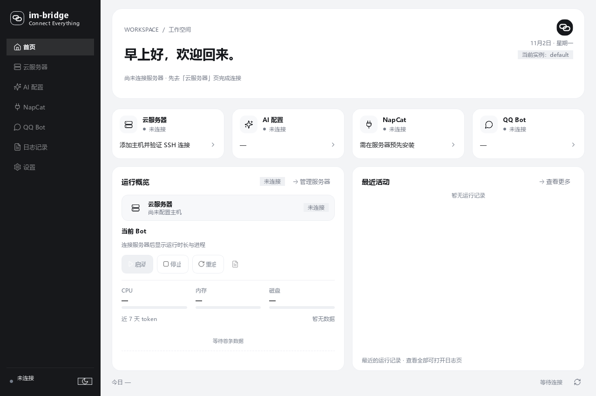

# im-bridge

Windows 桌面控制台，用于连接服务器、配置 AI、管理 NapCat 和 QQ Bot。

**当前版本：3.0.2** · [下载 Windows x64 控制台](https://github.com/yht758/im-bridge/releases/download/v3.0.2/im-bridge-console-v3.0.2-win-x64.zip) · [全部发布](https://github.com/yht758/im-bridge/releases) · [使用说明](docs/DESKTOP.md)

## 可以做什么

- 通过自己的 SSH 密钥连接服务器，查看连接与服务状态。
- 配置模型接口、密钥、账号权限、上下文、消息节奏和主动会话。
- 管理多个 Bot 实例，查看日志与用量。
- 查看与管理已经部署的 NapCat。
- 接入自己的本地语音服务、RVC 变声环境或云端 TTS，输入文字试听。
- 本地语音离线时继续回复文字。

## 开始使用

1. 下载并解压完整文件夹，运行 `IMBridgeConsole.exe`。
2. 提前在自己的服务器部署 Bot，并安装、登录 NapCat。
3. 在“云服务器”中填写服务器信息和自己的 SSH 私钥路径。
4. 在“AI 配置”中填写模型接口、密钥与 QQ 账号信息，再启动 Bot。

首次使用需要自行配置。公开下载包只包含纯色控制台与功能框架，**不附带服务器、账号、密钥、预设音色、语音权重或个人素材**。桌面程序运行时无需另外安装 Python；本地模型及其独立环境由用户自行准备。



## 语音接入

支持“本机直接合成”“云端底音 + 本机 RVC”“云端语音”三种来源。本机直接合成通过 SSH 反向隧道供云端 Bot 使用；本机离线时默认只发文字。控制台提供连接状态、启动/停止与试听入口。

没有内置默认声音。请按[语音接入说明](docs/DESKTOP.md#语音)配置自己的模型与服务。

## 源码与运行

```powershell
python -m pip install -r requirements-desktop.txt
python launcher/desktop_qt.py
```

仅运行聊天服务：安装 `requirements.txt`，配置自己的 `.env` / `config.json` 后运行 `python run.py`。样例文件不包含有效账号、接口密钥或模型配置。

```text
launcher/        桌面控制台、SSH 管理与本地语音桥接
src/im_bridge/  聊天服务、配置与 OneBot 接入
tests/          配置、聊天和语音链路验证
docs/           使用说明
```

Windows 构建方式见[桌面说明](docs/DESKTOP.md#构建下载包)。

## 反馈与贡献

[提交问题](https://github.com/yht758/im-bridge/issues) · [贡献指南](CONTRIBUTING.md) · [安全策略](SECURITY.md) · [MIT License](LICENSE)
